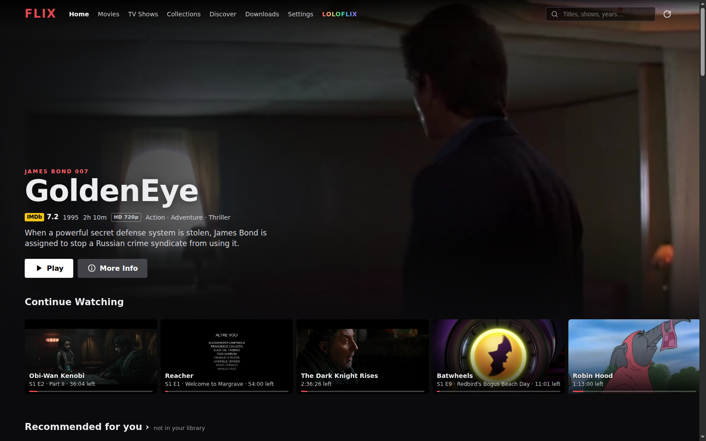
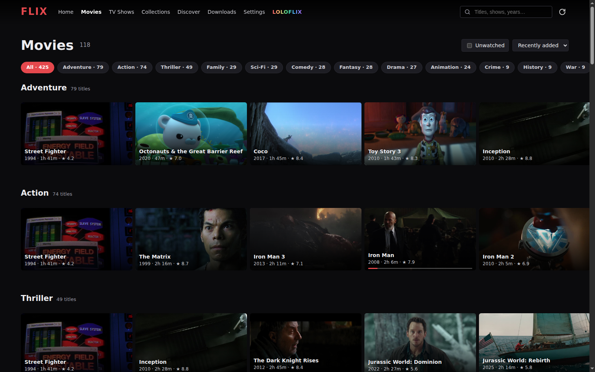
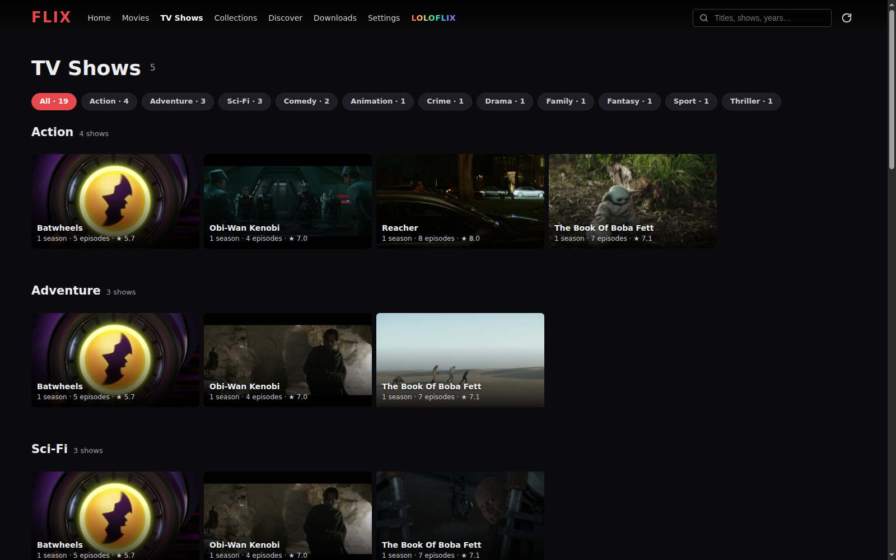
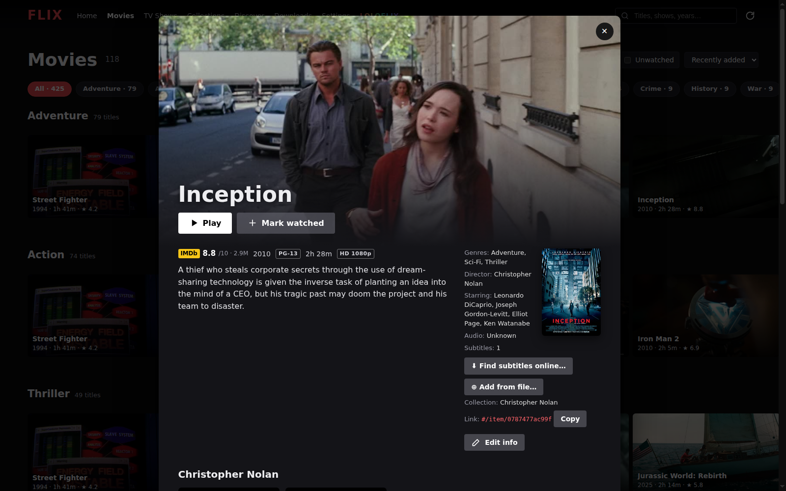
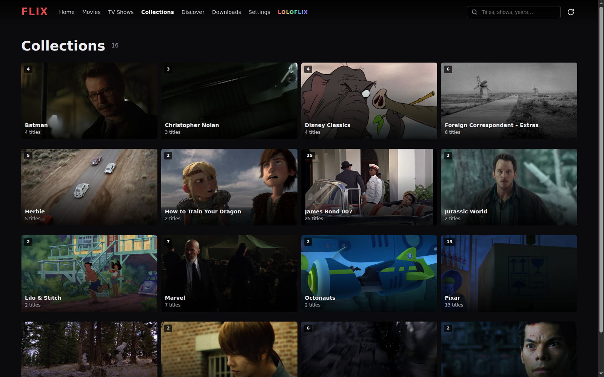
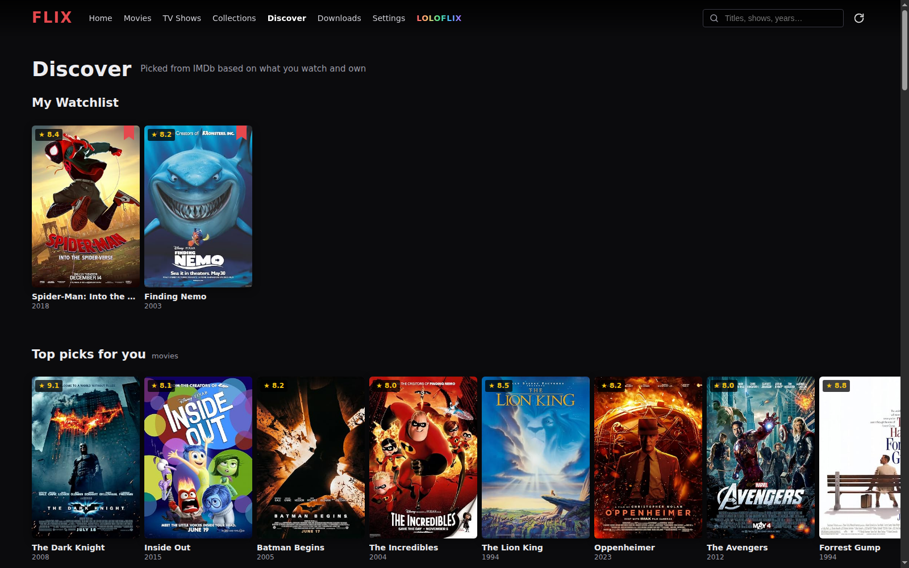
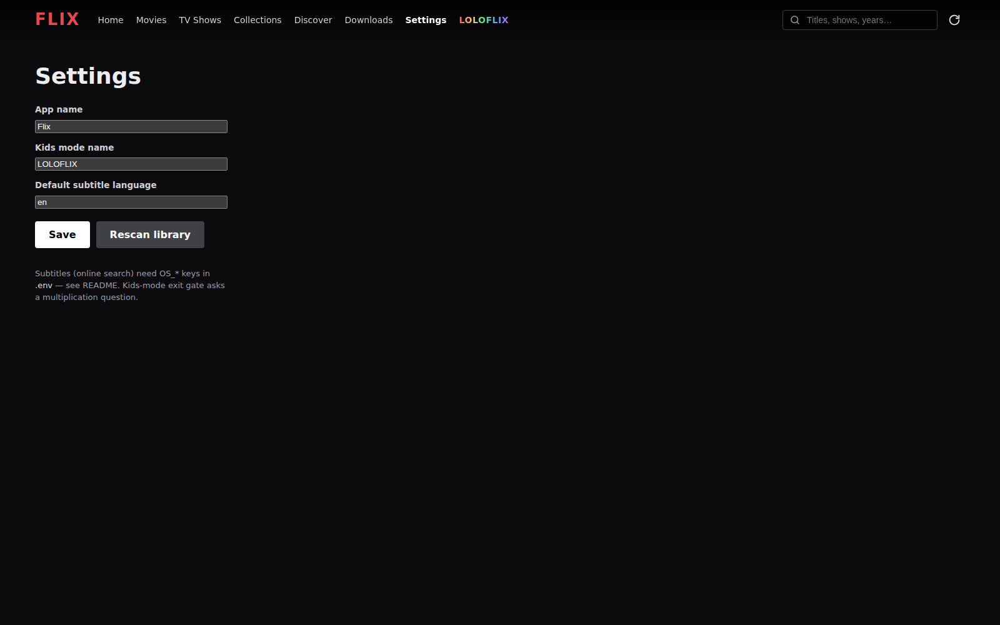
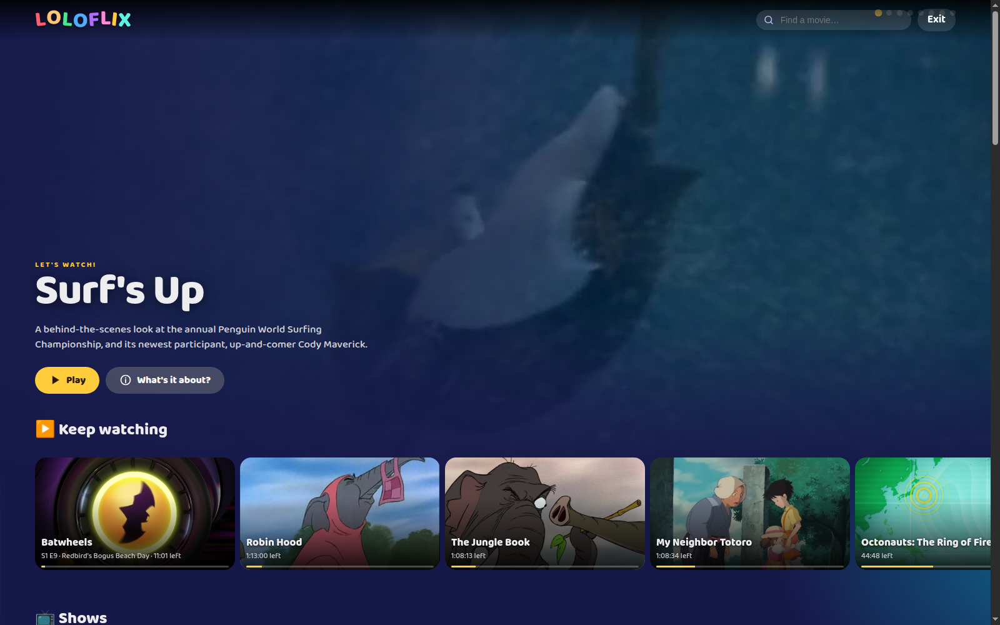

<div align="center">

# Flix

A small, self-hosted Netflix-style media server for a folder of video files — hero row,
Netflix-style shelves, TV seasons, kid mode, torrent grab, subtitles. One Node file, no build step.



</div>

## Screenshots

| | |
|---|---|
|  |  |
|  |  |
|  |  |
|  |  |

## Features

- **Library** — scans `MEDIA_DIR` recursively with ffprobe; movies, series (`SxxExx` filenames),
  collections, extras and "other" files are auto-detected
- **Collections** — franchises, studios and directors are grouped automatically (James Bond, Star Wars,
  Marvel, Batman, The Matrix, Pixar, Disney Classics, Christopher Nolan, …); rules live in
  `lib/parse.js`, and any title can be moved to another collection via "Edit info"
- **Home** — rotating hero, Continue Watching, Recently Added, per-genre / per-decade shelves,
  IMDb-powered "More like this" recommendations
- **Discover** — watchlist, popular/top charts and recommendations for titles *not* in your library;
  one click adds them to your watchlist, a matching torrent can be fetched with **Get torrent**
- **Torrents** — search (several public trackers, magnet-first) and hand off to a
  [Transmission](https://transmissionbt.com/) instance; live progress in the Downloads page
- **Player** — direct play → remux → transcode ladder (respects HDR/10-bit originals, NVENC when
  available), audio track + subtitle/quality pickers, resume across devices
- **Subtitles** — built-in tracks streamed as WebVTT (windowed, cached on disk); sidecar
  `.srt`/`.vtt` files next to a video; **online search** via OpenSubtitles; **Add from file** upload
  *(needs a free [OpenSubtitles API key](https://www.opensubtitles.org))*
- **Kid mode** — one-click themed experience (child-friendly titles only, exit gate with a
  multiplication question) — name it KIDSFLIX, LOLOFLIX or anything else on the Settings page
- **Settings page** — app name, kids-mode name, default subtitle language
- **Metadata** — ratings, posters, plots, cast from IMDb (2-week refresh cycle, override any title
  per "Edit info")

## Requirements

- Node.js 18+ (no npm packages needed at runtime except `torrent-search-api`)
- `ffmpeg` / `ffprobe` on `PATH`
- A Transmission RPC endpoint for torrent downloads (optional)

## Quick start

```sh
git clone <this-repo>
cd flix
npm install
cp .env.example .env   # set MEDIA_DIR to your video folder
npm start
# → http://localhost:8787
```

## Docker

```sh
cp .env.example .env   # set MEDIA_DIR + account vars
docker compose up -d   # flix + transmission, media mounted read-write
```

`docker-compose.yml` starts Transmission (RPC reachable only inside the compose network) and
the flix app. `.env` values are passed as compose environment variables.

## Environment variables

| Variable | Default | Purpose |
|---|---|---|
| `MEDIA_DIR` | `/mnt/nfs/movies` | Video folder |
| `PORT` | `8787` | HTTP port |
| `HOST` | `0.0.0.0` | Bind address |
| `IMDB` | `1` | `0` disables IMDb metadata lookups |
| `RESCAN_MINUTES` | `15` | Library rescan interval |
| `DATA_DIR` | `./data` | Metadata cache, thumbnails, settings |
| `TRANSMISSION_RPC_URL` | `http://127.0.0.1:9091/transmission/rpc` | Transmission JSON-RPC |
| `TRANSMISSION_USER` / `TRANSMISSION_PASSWORD` | / | Transmission auth |
| `OS_API_KEY` | / | OpenSubtitles — subtitle search |
| `OS_LOGIN` / `OS_PASSWORD` | / | OpenSubtitles — subtitle file download |

## Subtitles

1. Built-in mkv/mp4 tracks work out of the box (text tracks; image-based ones are listed but disabled).
2. Drop `.srt` / `.vtt` files next to a video (`Movie.2021.en.srt`, `Show S01E05.srt`) or use
   **⊕ Add from file…** in the title dialog.
3. **⬇ Find subtitles online…** searches [OpenSubtitles](https://www.opensubtitles.com) —
   set `OS_API_KEY` + `OS_LOGIN`/`OS_PASSWORD` in `.env` (both free).
   Free API keys have daily download limits.

## Notes / fair use

- Torrent search and IMDb scraping are read-only conveniences for content you already have
  access to — check the laws where you live. No links to pirated content are bundled.
- IMDb data is cached locally in `data/` (delete it to force a fresh lookup).
- Not affiliated with IMDb, OpenSubtitles, Transmission or Netflix. Names are used descriptively.

## License

MIT — see [LICENSE](LICENSE).